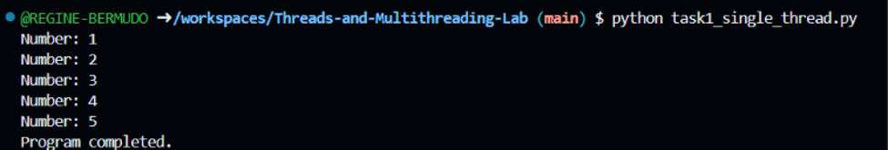
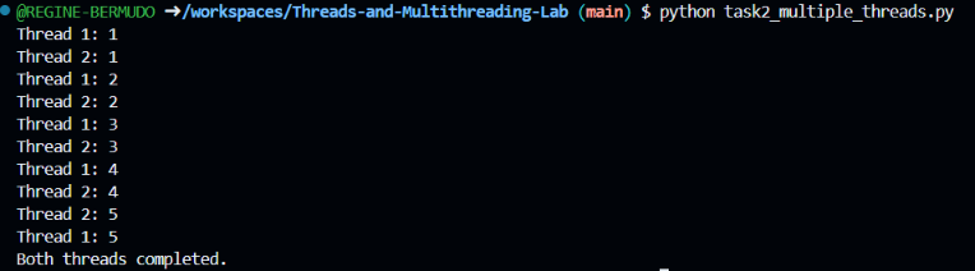
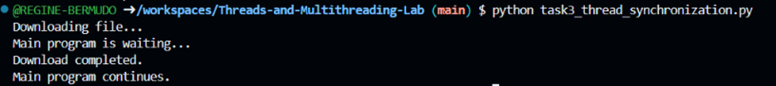

# Threads and Multithreading Laboratory

## Student Information
- Name: Ma. Regine Bermudo
- Section: B186.1
- Date: NOVEMBER 21, 2026

## Laboratory Description
This laboratory demonstrates thread creation,
multithreading, thread coordination, and
shared-resource management using Python.

## Repository Contents
| File | Description |
|------|-------------|
| `task1_single_thread.py` | Creates and runs a single thread, then waits with `join()` |
| `task2_multiple_threads.py` | Runs two threads concurrently |
| `task3_thread_synchronization.py` | Uses `join()` to make the main program wait for a thread |
| `task4_thread_lock.py` | Uses `threading.Lock()` to protect a shared counter |

## Completed Tasks
1. Single Thread

2. Multiple Threads

3. Thread Synchronization using join()

4. Shared Resource Management using Lock()


## How to Run
Make sure Python 3.x is installed, then run each program:

    python task1_single_thread.py
    python task2_multiple_threads.py
    python task3_thread_synchronization.py
    python task4_thread_lock.py

---

## Guide Questions and Answers

### Task 1: Creating and Executing a Single Thread

**1. What is the purpose of `threading.Thread()`?**
```
It creates a new thread object. The `target` argument tells it which function the thread will run.
```

**2. What happens when `start()` is executed?**
```
The thread begins running its target function concurrently with the main program.
```

**3. What is the purpose of `join()`?**
```
It makes the calling thread (the main program) wait until the thread has finished.
```

**4. What happens if `join()` is removed?**
```
The main program continues immediately, so "Program completed." may print before the numbers finish. The program still waits for the non-daemon thread before exiting, but the output order changes.
```
### Task 2: Implementing Multiple Threads

**1. How many threads are created in the program?**
```
Two threads (`t1` and `t2`), in addition to the main thread, which is always present.
```

**2. Do the two threads execute independently?**
```
Yes. Each thread runs its own function with its own loop, and neither waits for the other.
```
**3. Why might the output order change when the program is executed again?**
```
The operating system scheduler decides which thread runs and when. Small timing differences between runs change the interleaving of the output.
```
**4. What is the difference between sequential and concurrent execution?**
```
In sequential execution, one task must finish before the next starts. In concurrent execution, multiple tasks make progress during overlapping time periods.
```
### Task 3: Thread Synchronization Using join()

**1. Why does the main program wait when `join()` is used?**
```
join() blocks the calling thread until the target thread terminates, so the main program resumes only after the download is done.
```
**2. What happens when `join()` is removed?**
```
The main program does not wait, so "Main program continues." can print before "Download completed."
```
**3. In what situations is thread synchronization necessary?**
```
When one task depends on another's result (for example, processing a file only after it has downloaded), when threads share data, or when the program must finish or clean up in a particular order.
```
### Task 4: Managing Shared Resources Using Thread Locks

**1. What is a shared resource?**
```
Data or a device that more than one thread can access, such as the global variable `counter`.
```
**2. What is a race condition?**
```
A bug where the result depends on the unpredictable timing of threads accessing shared data. The statement `counter += 1` is really read, add, then write, so two threads can overwrite each other's updates.
```
**3. What is the purpose of `threading.Lock()`?**
```
It ensures only one thread at a time can run the protected code, providing mutual exclusion.
```
**4. What is a critical section?**
```
The part of the code that accesses a shared resource and must not be executed by more than one thread at the same time. In this lab, it is the `counter += 1` statement.
```
**5. Why is synchronization important when multiple threads access shared data?**
```
Without it, shared data can become inconsistent or wrong (lost updates), and results become unpredictable and hard to debug.
```
### General Questions

**1. What is the difference between a process and a thread?**
```
A process is an independent program with its own memory space and resources. A thread is a lightweight unit of execution inside a process that shares the process's memory and resources with its other threads.
```
**2. What are the advantages of using multithreading?**
```
Better responsiveness, easy resource sharing, lower overhead than creating processes, faster context switching, better CPU utilization during I/O waits, and the ability to use multiple cores.
```
**3. How does multithreading improve application responsiveness?**
```
Long tasks such as downloads or file I/O run in background threads, so the main or UI thread stays free to respond to the user instead of freezing.
```
**4. What is the difference between concurrency and parallelism?**
```
Concurrency means multiple tasks make progress during overlapping periods, possibly by switching on a single core. Parallelism means multiple tasks literally run at the same instant on multiple cores.
```
**5. Why is a lock necessary when multiple threads access shared data?**
```
It prevents multiple threads from modifying the same data at once, avoiding race conditions and corrupted results.
```
**6. What might happen if a thread is not properly synchronized?**
```
Race conditions, lost updates, inconsistent data, incorrect output, unpredictable behavior, and possibly deadlocks or crashes.
```
**7. Can multiple threads execute simultaneously on a single-core processor? Explain.**
```
No. A single core runs only one thread at any instant. Threads still run concurrently because the operating system rapidly switches between them (time slicing), which creates the illusion of simultaneous execution.
```
**8. How does the operating system manage kernel-level threads?**
```
The kernel knows about these threads directly. It creates them, schedules them on CPU cores, performs context switches, and handles blocking. Each thread has a kernel data structure (a thread control block). If one thread blocks on I/O, the kernel can run another thread of the same process, and threads can run on different cores.
```
---

## Learning Outcomes
- Create and execute threads.
- Demonstrate concurrent execution.
- Explain thread coordination.
- Apply locks to protect shared resources.